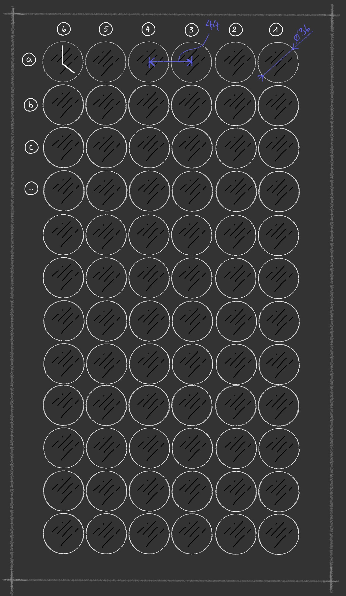
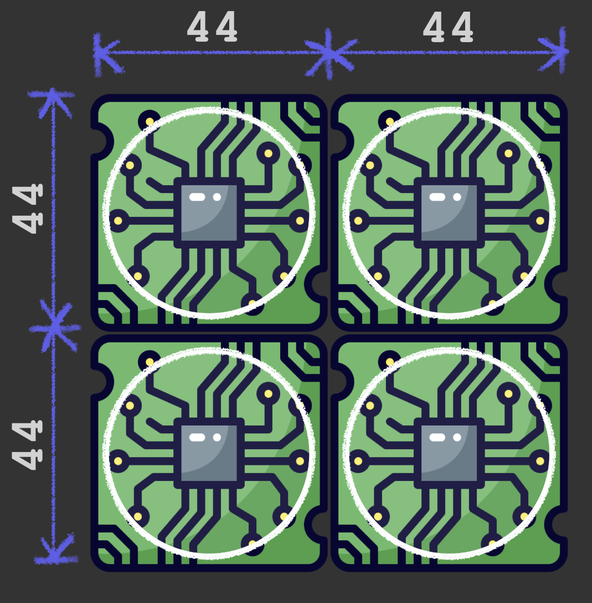
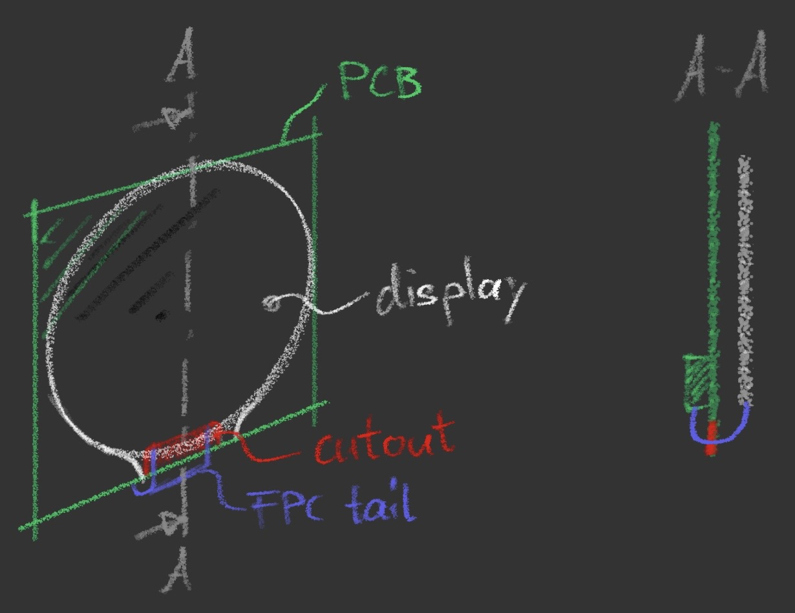
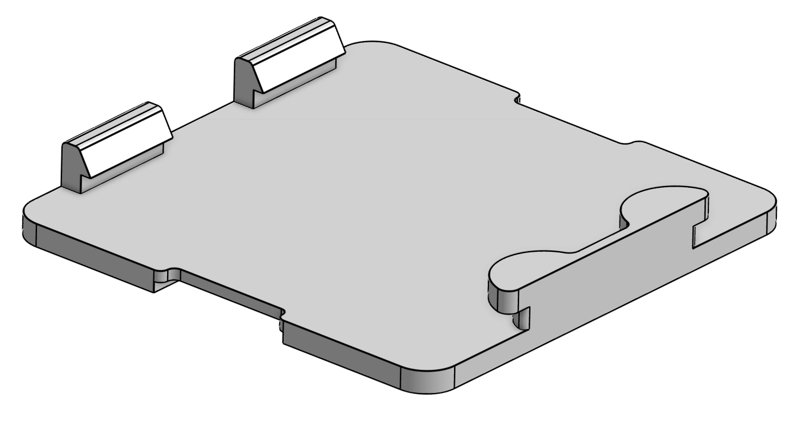
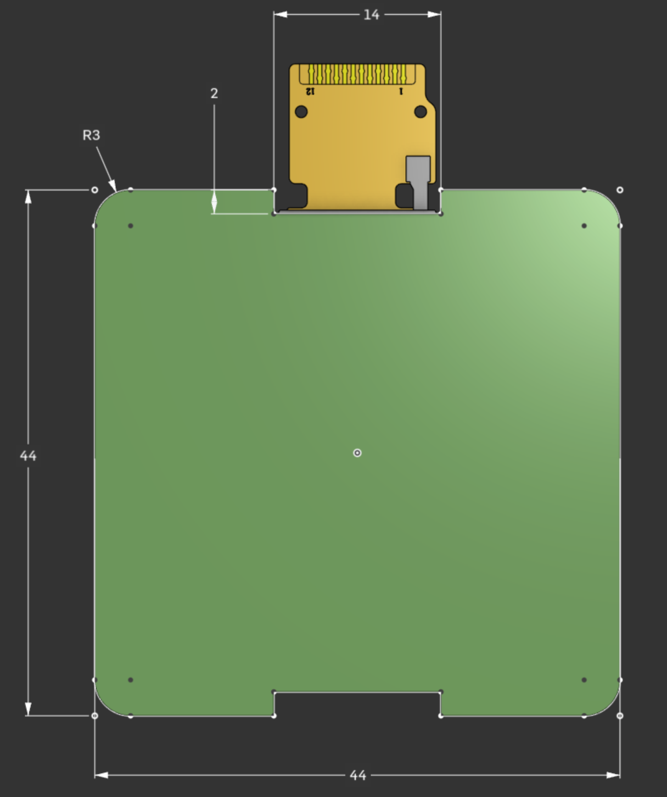

# Mechanical Design

The mechanical design covers the enclosure, the front plate and the 3D printed parts that hold the node PCBs in place. It also sets the constraints for the PCB outline.

All 3D models are made in OnShape and are available under this [public link](https://cad.onshape.com/documents/53aa7c255b66f5562a1ca156/w/211967f8d6f687de7cb12e88/e/a9185ed7945d5b9016d4c432?renderMode=0&uiState=6acfdefbca73a9d6ca868085).

## Contents

- [Concept](#concept)
- [PCB outline](#pcb-outline)
  - [Summary](#summary)
  - [Outer dimensions](#outer-dimensions)
  - [Display mounting](#display-mounting)
  - [FPC tail routing](#fpc-tail-routing)
  - [Bracket mounting](#bracket-mounting)
  - [Resulting outline](#resulting-outline)
- [Enclosure](#enclosure)

## Concept

The clock is a 12 x 6 grid of round displays, aligned vertically (Figure 1). A software change could tilt this alignment instead.

   
  <b>Figure 1:</b> Concept sketch of the clock layout

## PCB outline

> This section explains why the node PCB outline looks the way it does. It is the reference for the [PCB design](/pcb/README.md).

### Summary

| Requirement | Value | Reason |
| --- | --- | --- |
| Board size | Max. 44 x 44 mm | Display grid pitch |
| FPC connector | Vertical ZIF, contacts facing the PCB center | Excess tail forms a loop in Z, not in X/Y |
| Side cutouts | One on the left, one on the right | FPC tail can wrap around either edge |
| Bottom cutouts | Two round cutouts | Bracket pins slide in here |
| Top slot | One slot | Bracket clip grips the board here |

### Outer dimensions

The display's [technical drawing](/docs/datasheets/HZ0128QVPHGWS01N-AA.pdf) gives an outer diameter of ≈36 mm. A pitch of 44 mm between displays looks good, so each PCB must fit within **44 x 44 mm** (Figure 2).

   
  <b>Figure 2:</b> PCB outer dimensions (44 x 44 mm)

### Display mounting

The display panel sits behind the PCB. Its FPC tail wraps around the PCB edge to reach the connector (Figure 3). The tail needs a small cutout in the edge so it doesn't hit the neighboring PCBs.

The FPC contacts face away from the display (Figure 4, from the [technical drawing](/docs/datasheets/HZ0128QVPHGWS01N-AA.pdf)). The connector must be oriented to match.

<table>
  <tr>
    <td align="center" width="45%"></td>
    <td align="center" width="55%"></td>
  </tr>
  <tr>
    <td align="center"><b>Figure 3:</b> Node assembly: display, PCB and FPC tail</td>
    <td align="center"><b>Figure 4:</b> The FPC contacts face away from the display</td>
  </tr>
</table>

### FPC tail routing

Different suppliers of the same display use different tail lengths, so the routing must work for a range of lengths.

The neighboring PCBs leave no room in X and Y, so the tail must not stick out to the side. A **vertical ZIF connector** solves this: any excess tail forms a loop in the Z direction. That leaves three routing options (Figure 5).

   
  <b>Figure 5:</b> Three FPC tail routing options (side view)

| Option | Contacts face | Best for |
| ------ | ------------- | -------- |
| 1 | PCB center | Longer tails |
| 2 | PCB center | Longer tails |
| 3 | PCB edge | Short tails |

**Decision: options 1 and 2, contacts facing the PCB center.** The connector can only face one way, so a choice had to be made. Very short tails will not reach.

Options 1 and 2 wrap the tail around opposite edges, so the PCB needs a cutout on both sides.

### Bracket mounting

The PCB is mounted on a 3D printed bracket, with the display on the back of the bracket. The PCB clips on without screws (Figure 6):

- **Bottom:** two round cutouts. Two inward-facing pins on the bracket slide into them.
- **Top:** a slot. A clip on the bracket grips the board here.

   
  <b>Figure 6:</b> Bracket concept: pins at the bottom, clip at the top

### Resulting outline

   
  <b>Figure 7:</b> PCB outline with cutouts for the FPC tail and the bracket

## Enclosure

*In progress.* The 3D printed parts and the front plate will be documented here.
