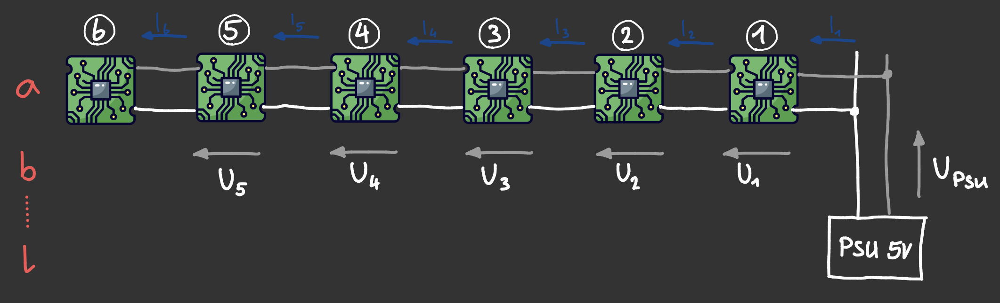

# Power Supply

This page describes how the 72 nodes are powered: the supply, the wiring and what voltage reaches each node. The power path on a single board (diodes, LDO) is described in the [PCB README](/pcb/README.md#power-supply).

## Power per node

Measured on the prototype board ([tests](/tests/README.md), section L), at about 5.1 V:

| Case | Current | Power |
| --- | --- | --- |
| Backlight off, CPU idle | 33 mA | 0.17 W |
| Clock running, backlight 100 % | 77 mA | 0.39 W |
| Worst case: backlight 100 %, CPU fully loaded | 84 mA | 0.42 W |

The backlight is the biggest part (about 40 mA). The CPU adds at most 8 mA, and the colour on the screen doesn't matter.

## Layout

The nodes are arranged in 12 rows of 6. Each row gets its own feed from the PSU at its first node. From there, power runs through the boards from node to node.

## Power supply

| | Worst case |
| --- | --- |
| One row (6 nodes) | 0.5 A |
| Whole clock (72 nodes) | 6.1 A, 30 W |

A 5 V PSU with 8–10 A leaves enough margin. One row stays far below the 2 A the JST connectors can carry (2 contacts × 1 A).

## Voltage at the last node

Every node needs at least **3.7 V** on the bus, otherwise its 3.3 V regulator can't keep up ([PCB README](/pcb/README.md#how-much-input-voltage-does-one-board-need)).

The resistances were measured on a chain of 4 nodes ([tests](/tests/README.md), section M):

| Part | Resistance |
| --- | --- |
| Feed cable from the PSU to the first node | 0.39 Ω (thin lab supply cable) |
| One hop from node to node | about 60 mΩ |

With these values, a row of 6 looks like this:

| PSU | Feed cable | Node 1 | Node 6 |
| --- | --- | --- | --- |
| 5.00 V | 0.39 Ω | 4.84 V | 4.78 V |
| 5.00 V | 0.10 Ω | 4.96 V | 4.90 V |
| 4.75 V | 0.39 Ω | 4.60 V | 4.55 V |
| 4.75 V | 0.10 Ω | 4.71 V | 4.65 V |

Even with a PSU at its lower limit (4.75 V, −5 %) and a thin feed cable, the last node has more than 0.8 V margin. The feed cable loses more than all 5 hops together, so it is worth using a short, thick one.

## Brightness

The backlight current is not regulated. It follows the supply voltage: about 2 mA less for every 0.1 V less. Measured: 39 mA at 5.09 V, 31 mA at 4.75 V.

What this means:
- **Lower supply, dimmer clock.** At 4.75 V instead of 5.0 V, the backlights are about 15 % dimmer. All nodes on the same supply dim together, so this is hard to notice.
- **Within a row, the difference is small.** Node 6 gets about 1.5 mA less than node 1, about the same as normal part tolerances.
- **Between rows, the feed matters.** If two rows get different voltages, their brightness differs visibly. So all rows should get the same voltage.
- **Don't set the PSU above 5.0 V.** At 5.25 V the LEDs would draw about 42 mA, above their 40 mA rating.

## Wiring rules

- One PSU for all rows, set to 5.0 V.
- One feed per row, all of the same length and wire gauge.
- Keep the feed cables short and thick (≤ 0.1 Ω for the round trip).

## Open points

- Inrush current at power-up (72 nodes switching on at once) hasn't been measured.
- Fusing per row.
- Power for the master board.
