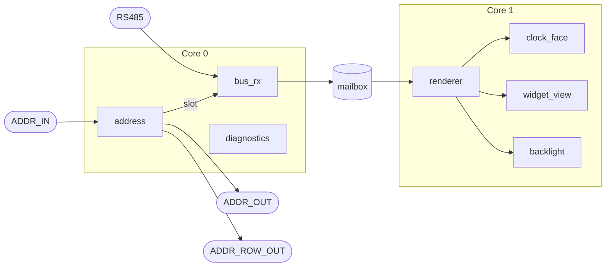
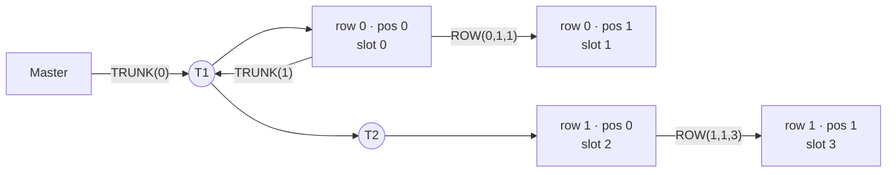

# Slave

The firmware for one node: an RP2040 driving one round GC9A01 display. All nodes run the same binary. The base principles are in the [software README](../README.md).

## Contents

- [Overview](#overview)
- [File map](#file-map)
- [Data flow](#data-flow)
- [Addressing](#addressing)
- [Build and flash](#build-and-flash)
- [Open points](#open-points)

## Overview

The slave is dumb. It learns its address from the ADDR chain, picks its own slot out of the master's broadcast and draws it. It never transmits on RS485.

The work is split across the two cores. Core 0 talks to the outside: RS485 and the ADDR chain. Core 1 owns the display. They meet in the mailbox, a single slot where the newest data always wins.



## File map

Each module is a `.h`/`.cpp` pair. The header is its interface.

| Module / file | Job | Core |
| --- | --- | --- |
| `main.cpp` | Startup and the two loops. Only connects the modules | both |
| `board.h` | Pins and constants | – |
| `LGFX_Config.hpp` | Display config for LovyanGFX | – |
| `address` | ADDR chain: receive, check, forward, repeat | 0 |
| `bus_rx` | RS485 bytes → frame, version check, picks its own slot | 0 |
| `mailbox` | Hand-over between the cores, latest wins | both |
| `renderer` | Decides what is on screen | 1 |
| `clock_face` | Draws the clock hands | 1 |
| `widget_view` | Draws a simple widget | 1 |
| `backlight` | PWM on GPIO21, brightness from `CLOCK_INIT` | 1 |
| `diagnostics` | Counters (frames, errors, gaps, render time), optional USB report | 0 |

The protocol comes from [`shared/protocol.h`](../shared/protocol.h).

## Data flow

From a byte on the bus to a pixel on the screen:

1. `bus_rx` collects bytes until `0x00` and decodes the frame. Bad frames are counted and dropped.
2. A frame with an unknown protocol version is not used. The screen shows the version error.
3. `bus_rx` drops frames for other nodes. From `CLOCK_UPDATE` it copies only this node's slot.
4. The data goes into the mailbox. Newer data overwrites older data that was not drawn yet.
5. Core 1 copies the mailbox once per loop and hands it to the renderer.
6. The renderer draws what has the highest priority:

| Priority | Condition | Screen |
| --- | --- | --- |
| 1 | Unknown protocol version | "Protocol vX, expected vY" |
| 2 | No valid address | "No address" |
| 3 | `CMD_DIAGNOSTIC` = 1 | "Row r · Pos p · Slot s" |
| 4 | Last init was `CLOCK_INIT` or `WIDGET_INIT` | Clock or widget |
| 5 | Address known, no init yet | "..." |

If no new data arrives, the screen keeps the last state.

## Addressing

The address is the node's position in the ADDR chain. The master maps it to a place on the grid. The connector PCBs at the branch points are passive.

Two frames travel on the ADDR wire, as a `SerialPIO` UART at 9600 baud. Both are COBS-encoded with an XOR checksum.

| Frame | Content | Received by |
| --- | --- | --- |
| `TRUNK` | row, row count, row lengths | The first node of a row |
| `ROW` | row, pos, slot, row length | All other nodes |

Every node follows the same rule:

- **Receives `TRUNK(k, lengths)`:** it is row k, pos 0. Its slot is the sum of the lengths of rows 0 to k-1. It sends `ROW(k, 1, slot+1, len)` on `ADDR_OUT` and `TRUNK(k+1, lengths)` on `ADDR_ROW_OUT`.
- **Receives `ROW(r, p, s, len)`:** it takes row, pos and slot. It sends `ROW(r, p+1, s+1, len)` on `ADDR_OUT`. `ADDR_ROW_OUT` stays an input.

Outgoing frames are repeated every 100 ms, so boot order does not matter. The master sends `TRUNK(0, lengths)` from its layout setting.

Example: the 2×2 as two rows of two.



A node shows "No address" instead of using a wrong slot when:

- the checksum is wrong
- row ≥ row count (more rows wired than configured)
- pos ≥ row length (row longer than configured)
- slot ≥ 72

The address is not stored in flash. It is found again at every boot and kept while the node runs.

**Pins**

| Pin | GPIO | Connector | Job |
| --- | --- | --- | --- |
| `ADDR_IN` | 9 | J3 | Receives `TRUNK` or `ROW` |
| `ADDR_OUT` | 10 | J2 | Sends `ROW` along the row |
| `ADDR_ROW_OUT` | 11 | J3 | First node of a row only: sends `TRUNK` back to the trunk. Named `SPARE_IN` on PCB v1 |
| `SPARE` | 8 | J2 | Not used, always an input. Named `SPARE_OUT` on PCB v1 |

## Build and flash

*The project does not exist yet. Planned:*

| Env | Upload |
| --- | --- |
| `pico` | USB (BOOTSEL) |
| `pico_swd` | CMSIS-DAP on J4 |

```
pio run -d software/slave -e pico_swd -t upload     # build and flash
pio device monitor -d software/slave                # USB report
pio test -d software/slave -e native                # unit tests on the PC
```

All nodes get the same binary. The address comes from the ADDR chain, not from the build.

## Open points

- Test the trunk on the 2×2 with a hand-soldered T-connector, before PCB v2.
- Display TE sync against the flicker from test H2, if it shows up on the 2×2.
